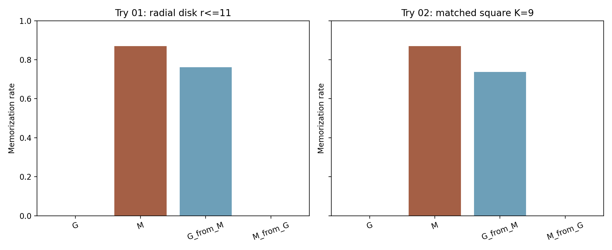
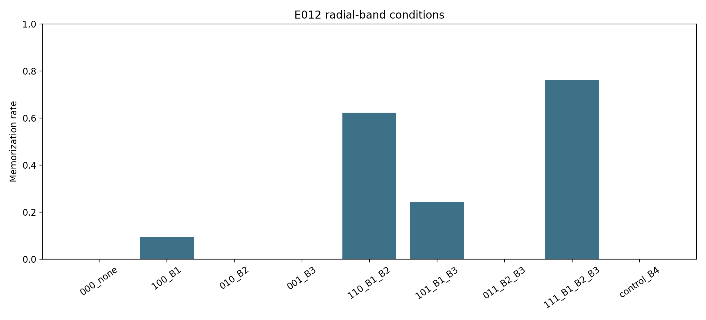

# Spectral Diffusion Playground

[](https://www.python.org/)
[](#reproduction)
[](LICENSE)

Controlled experiments on how spatial-frequency structure interacts with
memorization in diffusion models.

This project moves from frequency-resolved diagnostics to direct intervention.
Both diffusion models receive the same current sampler state; selected Fourier
coefficients of their **denoiser predictions** are exchanged; and the hybrid
prediction enters the unchanged deterministic Euler update. The central result
is strong, frequency-selective transfer of memorization behavior, followed by
evidence that the effect is distributed across interacting radial bands.

**Quick links:** [Key Result](#key-result) ·
[Experimental Idea](#experimental-idea) · [Main Findings](#main-findings) ·
[Controls](#experimental-controls) · [Detailed Record](docs/research_record.md) ·
[Reproduction](#reproduction)

## Key Result

During sampler calls `6..13` (`sigma` approximately `8.40` down to `0.14`),
the frozen wild-middle intervention replaces the generalizing model's radial
`r <= 11` denoiser coefficients with those from a memorizing model.
Memorization increased from **0.0% to 76.1%** while descriptive FID-1K changed
from **34.9014 to 38.0190**.

```text
generalizing baseline G:       0/1,000 =  0.0%
memorizing baseline M:       870/1,000 = 87.0%
radial G <- M:               761/1,000 = 76.1%
paired effect Delta_G:                    +76.1 pp
95% paired bootstrap CI:           [+73.4, +78.7]
```



A factorial follow-up localized this transfer within the successful radial
mask. The most informative comparison is:

```text
B1 (0 <= r <= 6):               9.5%
B2 (6 < r <= 9):                0.0%
B1 + B2:                       62.2%
full r <= 11:                  76.1%
adjacent B4 (11 < r <= 13):     0.0%
```

The dominant factorial interaction was **B1 x B2 = +52.35 percentage points**
with 95% CI **[+49.75, +54.95]**. These results support a strong
frequency-dependent interaction under this intervention. They do not establish
that one frequency band universally causes diffusion memorization.



## Why This Project?

Spectral measurements can show where image structure or denoising error lives,
but observational curves alone do not show whether those components can change
memorization. This repository builds the required Fourier foundations, relates
the analysis to the paper's diffusion memorization geometry, and then performs
controlled interventions on a frozen memorizing/generalizing EDM pair.

The resulting research arc is:

```text
diffusion memorization geometry
-> sigma/frequency diagnostics
-> controlled Fourier swapping
-> memorization transfer
-> radial frequency localization
-> open questions about time, frequency, and model dependence
```

## Experimental Idea

At each intervention call, the generalizing model `G` and memorizing model `M`
are evaluated on the **same current hybrid sampler state**:

```text
D_G(x_t, sigma_t),  D_M(x_t, sigma_t).
```

For a frozen Fourier mask `B`, the recipient prediction is

```text
FFT(D_hybrid) = (1 - B) FFT(D_G) + B FFT(D_M).
```

In plain language:

1. Start from one current sampler state.
2. Evaluate `G` and `M` on exactly that state.
3. Fourier-transform both denoiser predictions.
4. Copy only the selected coefficients from `M` into `G`.
5. Inverse-transform the hybrid prediction.
6. Continue the original deterministic Euler sampler.

The swap acts on the denoiser prediction, not on `x_t` or on completed images.
It is active only on calls `6..13`, the frozen wild-middle time window.

## Main Findings

### 1. Memorization Can Be Spectrally Transferred

For the radial `r <= 11` mask, `G <- M` moved from `0.0%` to `76.1%`
memorization. In the reverse direction, `M <- G` moved from `87.0%` to `0.0%`
with CI `[-89.0, -84.9]` percentage points, but its FID-1K degraded severely to
`97.6654`. The forward direction is therefore the cleaner intervention result.

### 2. The Effect Is Robust To Mask Geometry

A weighted-mode-count-matched square (`K = 9`) produced `73.7%` memorization
for `G <- M`, compared with `76.1%` for the radial disk. The paired difference
was `2.4` percentage points with CI `[1.5, 3.4]`. The large transfer effect
persists under a mode-count-matched square mask, so it is not specific to the
radial mask geometry.

### 3. The Effect Is Interaction-Dominated Across Radial Bands

E012 partitions `r <= 11` into B1 (`0 <= r <= 6`, 113 modes), B2
(`6 < r <= 9`, 140 modes), and B3 (`9 < r <= 11`, 124 modes). The adjacent
control B4 (`11 < r <= 13`) contains 152 modes.

| Coefficients copied from `M` into `G` | Memorization | FID-1K |
| --- | ---: | ---: |
| none | 0.0% | 34.9014 |
| B1 | 9.5% | 47.1730 |
| B2 | 0.0% | 49.7917 |
| B3 | 0.0% | 37.5288 |
| B1+B2 | 62.2% | 40.2796 |
| B1+B3 | 24.1% | 54.0809 |
| B2+B3 | 0.0% | 61.6959 |
| B1+B2+B3 | 76.1% | 38.0190 |
| adjacent B4 | 0.0% | 35.2534 |

Among the tested factorial subsets, every condition with nonzero memorization
contained B1, while B1 alone was far from sufficient. B1+B2 recovers `81.7%`
of the full-mask memorized seeds, and every seed memorized by a partial mask is
also memorized by the full mask. The dominant effect is the B1 x B2
interaction, not one isolated radial band.

## Experimental Controls

- Shared seeds `50000..50999` and deterministic pure-Euler sampling.
- Donor and recipient evaluated on the identical current sampler state.
- Fourier intervention applied to denoiser predictions, never to `x_t`.
- Untouched `G` and `M` baselines in E011; exact E011 radial reconstruction in E012.
- Radial disk versus effective-mode-count-matched square robustness check.
- Adjacent-frequency B4 control with more modes than any single E012 band.
- Deterministic CPU float64 nearest neighbors and strict `d1NN < d2NN / 3` rule.
- Continuous `d1NN/d2NN` diagnostics, descriptive FID-1K, and 100,000-resample
  paired bootstrap intervals.
- Frozen checkpoint, condition, mask, seed, configuration, and execution manifests.

## What The Results Do And Do Not Show

**Supported:** frequency-selective denoiser swapping during the frozen
wild-middle diffusion regime transfers memorization behavior between these two
models. Within `r <= 11`, the transfer is distributed and strongly
interaction-dependent.

**Not supported:** that middle frequencies universally cause memorization,
that `r <= 11` is a narrow middle-frequency annulus, that training-set size is
the causal model difference, or that reverse-direction suppression is cleanly
separable from image-quality degradation.

---

## Reproduction

Python 3.11 or newer is required for the reusable local experiments.

```bash
python3.11 -m venv .venv
source .venv/bin/activate
pip install --upgrade pip
pip install -r requirements.txt
pip install -e .
python -m unittest discover tests
```

E001-E004A can run locally with the documented inputs. Model experiments use
frozen external CIFAR-10 archives and EDM checkpoints; their exact hashes,
configurations, seeds, and guarded Slurm commands are recorded in the linked
protocol and result documents. No script downloads data or checkpoints
implicitly.

Large generated samples and checkpoint artifacts are not committed. Compact
summaries, manifests, validation records, and final figures are versioned in
this repository.

## Repository Layout

```text
spectral-diffusion-playground/
├── configs/      # frozen experiment configurations
├── data/         # small manifests, never downloaded datasets
├── docs/         # protocols, results, provenance, and full research record
├── experiments/  # executable experiment entry points
├── figures/      # curated reviewable figures
├── results/      # compact machine-readable outputs
├── scripts/      # guarded preflight and Slurm launchers
├── src/          # reusable FFT, intervention, and evaluation code
└── tests/        # numerical identities, determinism, and safeguards
```

## Experiment Index

| Experiment | Question and outcome |
| --- | --- |
| E001-E003 | Fourier visualization, noise spectra, and complementary frequency decomposition foundations. |
| E004 | Froze the operational CIFAR-10 cutoff at `r = 4`, with sensitivity at `r = 3,5`. |
| E004A-E004B | Reconstructed paper-derived geometry and resolved low/high candidate sigma locations. |
| E005 | Measured ordered low- then high-frequency denoising-residual transitions. |
| E006 | Historical whole-denoiser spectral-window swaps; formal outcome `INCONCLUSIVE`. |
| E007-E009 | Preserved blocked, retired, and negative model-pair paths without hiding failed gates. |
| E010 | Found selective suppression when the whole denoiser was swapped at a timing target derived from the high-frequency geometry. |
| E011 | Transferred memorization through selected denoiser-prediction Fourier coefficients. |
| E012 | Localized E011's radial transfer to a dominant B1 x B2 interaction. |

For the full methods, blocked paths, exact checkpoint identities, provenance,
and experiment-by-experiment conclusions, see the
[full research record](docs/research_record.md), [documentation index](docs/README.md),
[results index](results/README.md), and [figure index](figures/README.md).

## Limitations

- The E011/E012 intervention is demonstrated on one memorizing/generalizing
  checkpoint pair using CIFAR-10 and one deterministic sampler.
- E012 varies frequency while holding calls `6..13` fixed, so frequency and
  diffusion-time effects are not fully disentangled.
- Several partial and reverse interventions degrade image quality; the reverse
  E011 result is especially difficult to separate from its severe FID change.
- FID-1K uses 1,000 generated samples and is descriptive rather than a
  high-precision quality estimate.
- The successful `r <= 11` region includes low through intermediate radial
  frequencies; it is not a narrow middle-frequency annulus.
- The results support intervention-level transfer, not a universal claim that
  particular frequencies cause diffusion memorization.

## Citation And License

If you use this repository, cite it as software using [`CITATION.cff`](CITATION.cff)
and record the exact Git commit. Cite the grounding paper separately. Released
under the [MIT License](LICENSE).
