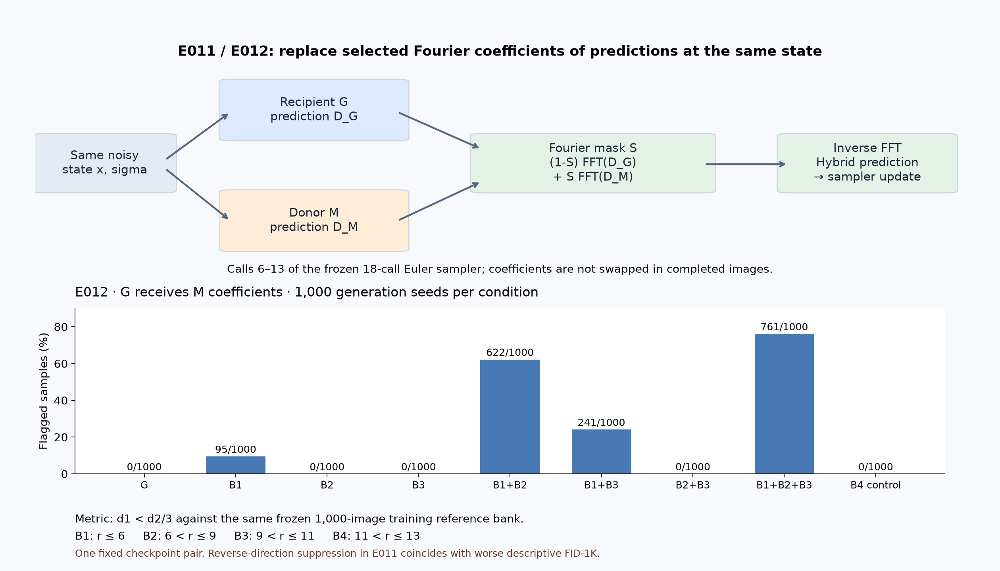

# Spectral Analysis of Diffusion Memorization

[](https://github.com/xinyugao233/Spectral-Analysis-of-Memorization-and-Generalization-in-Diffusion-Models/actions/workflows/cpu.yml)

**When can a diffusion model's denoiser predictions transfer memorization,
and which Fourier bands participate?** This project studies one fixed pair of
CIFAR-10 EDM checkpoints with frozen interventions and paired generation seeds.
The new CPU workflow is staged locally; hosted CI has not yet run for this change.

## Main finding

Replacing selected Fourier coefficients of same-state denoiser predictions
changed the flagged count from **0/1,000 to 761/1,000** in E011's radial-mask
G-from-M condition: **+76.1 percentage points**, paired bootstrap 95% interval
**[73.4, 78.7] pp**. The metric is `d1 < d2/3`, using Euclidean distances to
the nearest and second-nearest images in the same frozen 1,000-image training
reference bank. [Counts](results/experiment_11/experiment_11_condition_summary.csv)
· [Paired effects](results/experiment_11/experiment_11_paired_effects.csv).

**M** denotes the memorizing EDM checkpoint trained on 1K images; **G** denotes
the EDM checkpoint trained on 50K images with zero observed hits against this
reference bank. These are operational names, not universal model properties.
G's 0/1,000 does not establish absence of memorization across its full 50K set.



This is a derived explanatory figure from the frozen E012 table, not a new
experiment. [Source and provenance](docs/maintenance/presentation.md).

## What changes in each experiment

- **E010:** swap the **whole denoiser** at geometry-selected sampler calls.
  Frequency determines when to intervene; individual Fourier components are
  not the intervention.
- **E011:** evaluate recipient and donor on the **same noisy state** and replace
  selected Fourier coefficients of their denoiser predictions during calls
  `6..13` of the frozen 18-call Euler sampler (`sigma ≈ 8.40..0.14`).
- **E012:** test subsets and combinations of radial bands in that same window.
  B1 is `r ≤ 6`; B2 is `6 < r ≤ 9`; B3 is `9 < r ≤ 11`;
  the adjacent control B4 is `11 < r ≤ 13`.

The E011 disk `r ≤ 11` contains 377 modes. Its square control contains 361;
these are **approximately mode-count-matched**, not identical in size.
The mask acts on predictions, not training noise, loss weights, or final images.
[Protocol](docs/experiment_11_fourier_component_swap_protocol.md).

## Results and scope

All rates below use the strict nearest/second-nearest criterion and the same
1K reference bank; seeds are paired within an experiment. E010 uses generation
seeds `40000..40255`; E011/E012 use `50000..50999`.

| Experiment | Intervention and observed result | Evidence |
|---|---|---|
| E010 | Whole-denoiser high-derived suppression: 141/256 flagged; neighboring controls 167/256 and 170/256. Target-minus-mean-control suppression: +10.74 pp, paired 95% CI [6.84, 14.84]. | [Directional analysis](results/experiment_10/experiment_10_directional_analysis.csv) |
| E011 | G-from-M disk: 761/1,000; square: 737/1,000; G baseline: 0/1,000. | [Condition summary](results/experiment_11/experiment_11_condition_summary.csv) |
| E011 reverse | M-from-G: 0/1,000 versus M 870/1,000, alongside worse descriptive FID-1K: 43.4477 → 97.6654 (disk), 99.3803 (square). Suppression does not establish quality preservation. | [Results and limitations](docs/experiment_11_fourier_component_swap_results.md) |
| E012 | B1: 95/1,000; B2 and B3: 0/1,000 each; B1+B2: 622/1,000; full mask: 761/1,000; B4: 0/1,000. | [Condition summary](results/experiment_12/experiment_12_condition_summary.csv) |

E012's B1×B2 contrast is **52.35 pp [49.75, 54.95]**, under the frozen
finite-difference scaling: the two-factor contrast averages over the remaining
factor, dividing the signed eight-cell sum by 2. Interaction means nonadditivity
of the measured binary outcome. B1+B2 recovers **622/761 = 81.7%** of full-mask
flagged seeds. [Contrasts](results/experiment_12/experiment_12_factorial_contrasts.csv)
· [Observed overlap](results/experiment_12/experiment_12_full_mask_overlap.csv).

E010 induction produced **0–1 flagged samples out of 256 per condition**;
neither target outperformed its controls. A zero baseline does not itself
floor-limit detection of an increase. Only high-derived suppression met the
frozen criterion. [E010 counts](results/experiment_10/experiment_10_condition_summary.csv).

## What the project implements and reuses

Project code implements frequency-resolved geometry, frozen condition/seed
registries, same-state Fourier interventions, paired statistics, integrity
checks, and reporting. The EDM models, training infrastructure, trained
checkpoint pair, CIFAR-10, and grounding paper are external inputs.

The E009 warm-start loop is explicitly an NVIDIA EDM derivative under
CC BY-NC-SA 4.0. Original materials retain their established MIT scope;
[third-party notices](THIRD_PARTY_NOTICES.md) explain the distinction.
This page uses project-level attribution rather than inferring personal authorship.

## Working CPU quickstart

No GPU, dataset, checkpoint, network request, or inference is needed **after
installation** to check available tables. Installation downloads dependencies.
The pinned CPU review environment is Python 3.13; exact local versions and
hosted-CI status are recorded in [maintenance verification](docs/maintenance/verification.md).
Historical CUDA environments remain separately identified in run manifests.

```bash
python3.13 -m venv .venv
source .venv/bin/activate
python -m pip install -c constraints-review.txt -e .
python -m unittest discover -s tests
python scripts/verify_artifacts.py
python scripts/analyze_results.py --mode aggregate --output-dir outputs/aggregate-review
```

Expected result: count/rate/denominator consistency for E010–E012, with
`analysis.json` in the new output directory. This takes under one second in
the recorded local review environment. Reusing an output directory is refused.
Missing external files are listed explicitly by the verifier and do not count
as verified. `--require-external` makes their absence a failing exit status.
Aggregate checks do not reproduce paired intervals or recover seed overlap.

## Reproduction levels and availability

| Level | Inputs | Status |
|---|---|---|
| Code and CPU tests | Declared dependencies | Verified locally; hosted CI pending |
| Aggregate consistency | Tracked summaries | Runnable from this checkout |
| Paired analysis | Original per-sample CSVs | Recovered from Hellbender, exact hashes verified, results reproduced locally; publication pending |
| Model inference | Trusted EDM checkpoints, archive/reference bank, executed source environment | External checkpoints identified and hashed; inference not rerun |
| Full historical provenance | Exact executed dirty EDM tree | Current patch retained; historical equivalence not established |

For authorized holders of the original rows, place the three files named
`experiment_10_per_sample.csv`, `experiment_11_per_sample.csv`, and
`experiment_12_per_sample.csv` in a directory, then run:

```bash
python scripts/analyze_results.py --mode paired --input-dir /path/to/original-rows --output-dir outputs/paired-review
```

The command checks original file hashes, unique keys, full seed coverage,
nearest-neighbor distances, strict labels and complete pairing. It reproduces
paired effects, percentile intervals (100,000 resamples, seed 0), factorial
contrasts and overlap, then compares computed columns at absolute tolerance
`1e-12`. It writes new JSON/CSV tables. The local all-experiment pass took
about 6.3 seconds. No samples, FID measurements, or training runs are created.
Missing inputs cause an error naming the required file, hash and source.
[Analysis contract](docs/maintenance/analysis.md) · [Artifact inventory](docs/maintenance/artifacts.md).

Inference remains in the historical experiment entry points. Their external
EDM, checkpoint, data, and cluster requirements apply; the table-analysis
command is the portable route for result reproduction.

## Source reading guide

| Question | Start here | Checks/evidence |
|---|---|---|
| How are timing targets frozen? | [Region definitions](docs/canonical_experiment_pipeline.md) | [Registry tests](tests/test_region_definitions.py) |
| What is a whole-denoiser intervention? | [E010 implementation](src/spectral_diffusion_playground/e010_directional_transfer.py) | [E010 results](docs/experiment_10_directional_memorization_transfer_results.md) |
| How are prediction coefficients swapped? | [E011 implementation](src/spectral_diffusion_playground/e011_fourier_component_swap.py) | [E011 protocol](docs/experiment_11_fourier_component_swap_protocol.md) |
| How are interactions defined? | [E012 implementation](src/spectral_diffusion_playground/e012_frequency_localization.py) | [E012 contrasts](results/experiment_12/experiment_12_factorial_contrasts.csv) |
| How can tables be analyzed alone? | [CPU table analysis](src/spectral_diffusion_playground/table_analysis.py) | [Analytic fixtures](tests/test_table_analysis.py) |
| What bytes are verified? | [Public artifact manifest](docs/maintenance/public_artifacts.json) | [Verifier](scripts/verify_artifacts.py) |

## Limitations

The 1,000 seeds are generation seeds for one fixed checkpoint pair, not
independently trained models. Their confidence intervals do not establish
robustness across training runs or datasets. The model pair differs in data
size and training history, so dataset-size causality is not isolated.

All-zero empirical-bootstrap intervals describe the observed sample and do
not prove a population rate or effect is exactly zero. FID-1K is descriptive;
the reverse-direction quality degradation must accompany suppression claims.
No privacy guarantee, universal frequency mechanism, or quality-preserving
intervention is established.

Earlier E004A–E006 work is a disclosed clean-room extension of the grounding
paper rather than an exact reproduction of its unavailable executed code.
E006 remains formally inconclusive; E007–E009 blocked/retired historical states
remain in the [full research record](docs/research_record.md).

## Detailed history and citation

- [Documentation index](docs/README.md), [results index](results/README.md),
  [figures index](figures/README.md), and [full research record](docs/research_record.md).
- [E010 protocol](docs/experiment_10_directional_memorization_transfer_protocol.md),
  [E011 protocol](docs/experiment_11_fourier_component_swap_protocol.md),
  [E012 protocol](docs/experiment_12_frequency_localization_protocol.md).
- Cite this software with [CITATION.cff](CITATION.cff) and the exact commit;
  cite the grounding paper separately. See [license scope](THIRD_PARTY_NOTICES.md).
- [Maintenance status and handoff](docs/maintenance/verification.md).
